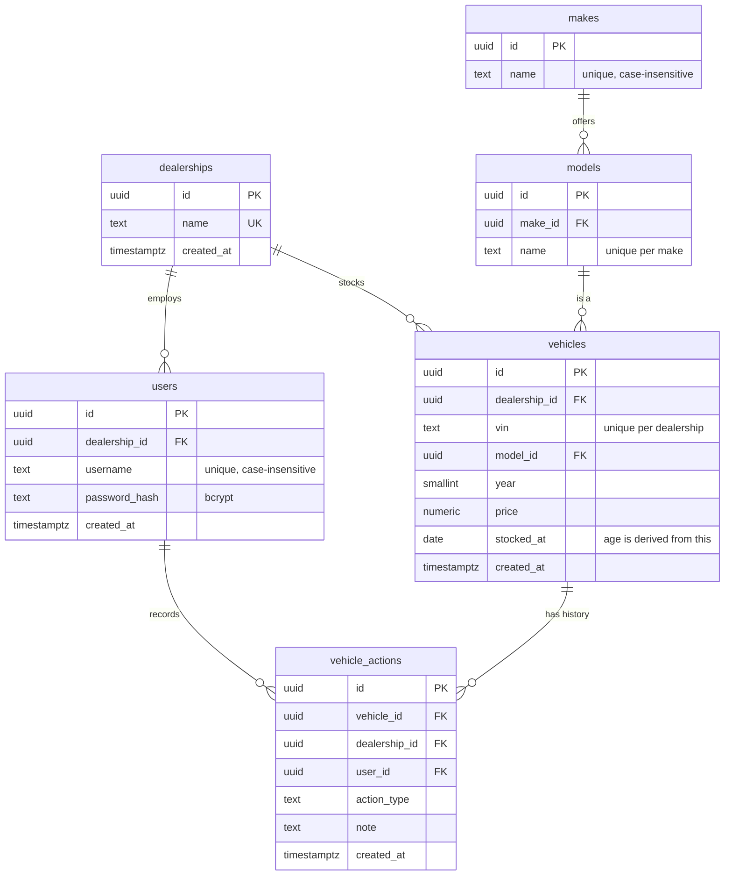

# Database Design

PostgreSQL 17. The schema is created by `backend/migrations/000001_init.up.sql` (golang-migrate format, with a matching `.down.sql`).

## ERD



## Tables

| Table | Notes |
|---|---|
| `dealerships` | The tenant. `name` is unique and is the natural key used by the seed files. |
| `users` | A dealership has many users; each user belongs to exactly one dealership (A4). All users of a dealership have equal, full access to its stock and actions, so there is no role column. `vehicle_actions.user_id` records who acted, for audit only. Username is unique across all dealerships on `lower(username)` because login has no dealership field. Only a bcrypt hash is stored. |
| `makes`, `models` | Shared catalog of manufacturers and their models, so each name is stored once and spelling cannot drift (`Toyota` vs `toyota`). Reference data, not tenant data, so there is no `dealership_id`. Names are unique case-insensitively (models: per make). |
| `vehicles` | Current stock (A9). `model_id` points to the catalog; the make is reached through `models.make_id`, so a vehicle cannot be a mismatched make and model. `year` is the vehicle's model year and stays a plain column: it has no attributes of its own. `VIN` must be 17 characters without I, O or Q and is unique **per dealership**, so the same car can appear in two dealerships (for example after a transfer). `stocked_at` is the only age-related column. |
| `vehicle_actions` | Append-only history (A7). Rows are never updated or deleted. |

### Design points

- **Age is derived, never stored (A2).** A vehicle is aging when `stocked_at < CURRENT_DATE - 90`, which means more than 90 days (A1). Written this way the predicate compares the bare column, so the index below can serve it. The `90` is passed as a query parameter, so making it configurable later changes only where the value comes from.
- **Tenant integrity is enforced by the database.** `vehicle_actions` carries `dealership_id` and a composite foreign key `(vehicle_id, dealership_id) -> vehicles (id, dealership_id)`. An action cannot be attached to a vehicle of another dealership, even through a buggy query.
- **Action types are a `CHECK` list**, not a lookup table, because the set is small and fixed (A6): `price_reduction_planned`, `promotion_planned`, `transfer_planned`, `wholesale_planned`, `hold`. The same values appear in the OpenAPI enum. Changing the list is a new migration.
- **Notes** are optional and capped at 500 characters.
- **Current status** is the newest action for the vehicle; there is no mutable status column.

## Indexes

| Index | Query it serves |
|---|---|
| `vehicles_dealership_stocked_at_idx (dealership_id, stocked_at)` | Inventory list scoped to a dealership, the aging filter and sort by age. |
| `vehicles_dealership_model_idx (dealership_id, model_id)` | Model filter. The make filter selects the make's model ids through `models.make_id`. |
| `makes_name_key (lower(name))`, `models_make_name_key (make_id, lower(name))` | Catalog uniqueness and the filter dropdown lists. |
| `vehicle_actions_vehicle_created_idx (vehicle_id, created_at DESC)` | Latest action per vehicle and the history list for one vehicle. |
| `users_username_key (lower(username))` | Login lookup. |
| `users_dealership_id_idx`, unique `(dealership_id, vin)` | Foreign-key lookups and VIN uniqueness. |

Reference queries:

```sql
-- Aging stock for a dealership, oldest first, with each vehicle's latest action
SELECT v.id, v.vin, k.name AS make, m.name AS model, v.year, v.price,
       CURRENT_DATE - v.stocked_at AS age_days, a.action_type, a.note
FROM vehicles v
JOIN models m ON m.id = v.model_id
JOIN makes k ON k.id = m.make_id
LEFT JOIN LATERAL (
    SELECT action_type, note
    FROM vehicle_actions
    WHERE vehicle_id = v.id
    ORDER BY created_at DESC
    LIMIT 1
) a ON true
WHERE v.dealership_id = $1
  AND v.stocked_at < CURRENT_DATE - $2::int   -- $2 = 90
ORDER BY v.stocked_at;
```

## Migrations

Numbered SQL files in `backend/migrations/`, applied with golang-migrate (`migrate -path backend/migrations -database "$DATABASE_URL" up`). Applied migrations are never edited; changes are new files. Every migration has a down file.

## Seed data

CSV files in `backend/seed/`:

| File | Columns |
|---|---|
| `dealerships.csv` | `name` |
| `models.csv` | `make`, `model` (the catalog; makes are derived from the distinct `make` values) |
| `users.csv` | `dealership`, `username`, `password` (plaintext **demo** values, hashed by the loader) |
| `vehicles.csv` | `dealership`, `vin`, `make`, `model`, `year`, `price`, `age_days` (make and model are names, resolved to `model_id` by the loader) |

Vehicles use `age_days` rather than a fixed date, and the loader sets `stocked_at = CURRENT_DATE - age_days`. Fixed dates would make every vehicle look older each day and eventually turn the whole demo inventory into aging stock.

The data has 3 dealerships, 7 makes, 21 models, 6 users and 150 vehicles (50 per dealership); about 27% are over 90 days old. Each dealership includes vehicles at exactly 90 and 91 days to exercise the boundary.

The loader inserts with `ON CONFLICT DO NOTHING` on the natural keys (dealership name, make name, `(make, model)`, username, `(dealership, vin)`), so it can be re-run safely. It is implemented together with the backend.

## Verification

Run against a real PostgreSQL 17 container: the migration applies and reverses cleanly; the CSVs load and reload idempotently (150 vehicles both times); age 90 evaluates as not aging and 91 as aging; and the index is used for the aging predicate. Inserts with an invalid action type, a cross-dealership action, a malformed VIN, a case-variant duplicate username or make, a duplicate model, a vehicle without a model, and a repeated VIN within one dealership are each rejected by the database, while the same VIN in a different dealership is accepted.
