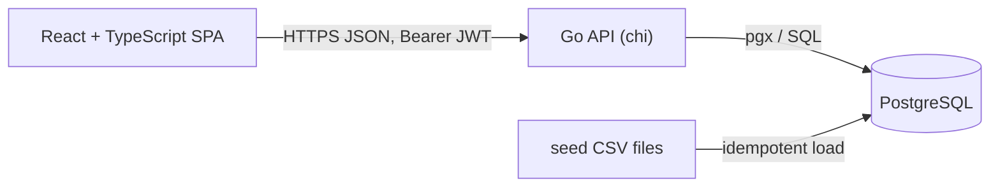

# System Design: Intelligent Inventory Dashboard

## 1. Goal and scope

Give dealership managers an overview of their vehicle stock, surface **aging stock** (in inventory for more than 90 days) and let them record the action planned for each aging vehicle.

**In scope**
- Filterable inventory list (make, model, age, and status)
- Automatic aging identification, prominently displayed
- Action log per aging vehicle, persisted with history
- Multiple dealerships with username/password login (JWT) and strict data isolation
- CSV-based mock data

**Out of scope** (see [Future evolution](#7-future-evolution))
- Live push updates, user management UI, vehicle create/edit, DMS integrations

## 2. Assumptions

The brief allows ambiguity as long as it is documented.

| # | Assumption |
|---|---|
| A1 | "Age" is the number of whole days since the vehicle entered the dealership's stock (`stocked_at`). A vehicle is *aging* when age is **greater than 90** days (90 exactly is not aging). |
| A2 | Age is computed at query time from `stocked_at` and is never stored, so it cannot go stale. |
| A3 | The 90-day threshold is a single constant in this version (see 7.1 for the configurable design). |
| A4 | A dealership has many users (1:n); each user belongs to exactly one dealership. Every user of a dealership has the same full permissions: view all of that dealership's stock and log actions on any of its vehicles. There are no roles or per-user restrictions within a dealership, and no access to other dealerships' data. |
| A5 | Authentication is username + password; the API issues a short-lived JWT. No registration, password reset or roles beyond "dealership user". Users are seeded. |
| A6 | Actions are chosen from a fixed list (*Price Reduction Planned*, *Promotion Planned*, *Transfer Planned*, *Wholesale Planned*, *Hold*) with an optional free-text note. |
| A7 | Action history is append-only. A vehicle's *current* status is its most recent action. |
| A8 | "Real-time" means fresh data on page load and manual refresh. No push updates. |
| A9 | Only vehicles currently in stock are listed. Sold vehicles are out of scope. |
| A10 | Mock data (dealerships, users, make and model catalog, vehicles) is stored as CSV and loaded idempotently. All credentials in it are fake demo values. |
| A11 | Actions can only be logged on **aging** vehicles. Logging one on a non-aging vehicle is rejected with `409 vehicle_not_aging`. Reading the history of any vehicle is allowed. |
| A12 | Inventory age filtering supports an `aging` flag plus inclusive `min_age_days` / `max_age_days` bounds. Make and model filters use catalog ids. Results are paginated (default 25, max 100) and default to oldest first. |
| A13 | The API reports the threshold in force (`aging_threshold_days`) in the inventory summary, so the client never hardcodes 90 and the configurable design in 7.1 needs no client change. |
| A14 | The API does not state a currency. Prices are shown as US dollars; this is one constant in the frontend (`src/shared/format.ts`). |
| A15 | Inventory filters live in the URL, so a filtered view can be shared, bookmarked and survives refresh. Changing a filter returns to page 1. A model can only be chosen after a make. Age bounds apply when a field loses focus or on Apply, not on every keystroke. |
| A16 | The page size is fixed at 25. The detail page links back to the same filtered view. |

## 3. Architecture

| Component | Responsibility |
|---|---|
| **SPA** | Login, inventory table with URL-driven filters, aging highlight, action dialog and history. |
| **API** | Authentication, request validation, tenant scoping, inventory queries, action recording. Stateless, so it scales horizontally. |
| **PostgreSQL** | Source of truth. Enforces integrity with constraints and foreign keys. |
| **Seed loader** | Loads dealerships, users and vehicles from CSV on demand. |

The API is organised by feature (`auth`, `inventory`, `actions`) with shared infrastructure in `platform`. This keeps related code together and avoids a layered folder structure that spreads one feature over many directories.

## 4. Key decisions

| Decision | Options | Choice | Trade-off |
|---|---|---|---|
| Backend language | Go, Node, .NET | **Go** | Small, fast, easy to deploy; more verbose than Node. |
| Database | SQLite, PostgreSQL | **PostgreSQL** | Real concurrency, constraints and indexing; needs a container to run. |
| Age handling | Stored column, computed | **Computed at query time** | Always correct and no batch job; the query must be indexed well. |
| Current status | Mutable column, append-only history | **Append-only history**, latest row is current | Full audit trail; reads need a "latest per vehicle" query. |
| Auth | Sessions, JWT | **JWT (HS256, short expiry)** | Stateless and simple; no server-side revocation in v1. |
| Tenancy | Per-dealership schema, shared schema | **Shared schema, `dealership_id` on every row** | Simple and cheap; isolation depends on every query filtering by tenant (enforced in the repository layer and tested). |
| API contract | Code-first, spec-first | **OpenAPI spec first**, TypeScript types generated | Frontend and backend cannot drift; adds a generation step. |
| Freshness | Polling, SSE, refresh on load | **Refresh on load** | Meets the requirement with no extra infrastructure. |
| Frontend contract | Hand-written types, generated types | **Types generated from `openapi.yaml`** (`openapi-typescript`, `openapi-fetch`) | A contract change is a compile error in the UI; `npm run check:api` fails if the generated file is stale. |
| Frontend state | Redux, context, TanStack Query | **TanStack Query** for server state, the URL for filters | No hand-written caches or loading flags; views are shareable. No global store is needed. |
| Styling | Component library, Tailwind, plain CSS | **Plain CSS** with variables, light and dark themes | No dependency to maintain for a handful of screens. |

## 5. Security and multi-tenancy

- Authorisation is by dealership only: any authenticated user may view and act on all stock of their own dealership (A4) and none of any other. Finer-grained roles are listed under future evolution.
- Passwords hashed with bcrypt. The JWT carries the user id (`sub`) and the dealership id (`did`).
- `dealership_id` is taken **only from the token**, never from the request. Repository methods require it as a parameter, so a query cannot be written without a tenant.
- Requesting another dealership's vehicle returns `404`, which does not reveal that it exists.
- All SQL is parameterised. Input is validated at the handler boundary and list endpoints cap page size.
- Secrets come from environment variables. Demo credentials exist only in seed data.
- **Where the browser keeps the token.** The API issues one short-lived access token and no refresh token, so the frontend must keep it somewhere. It uses `sessionStorage`: the session survives a page refresh and ends when the tab closes. The alternative, memory only, is safer against script injection but signs the user out on every refresh. The residual risk is that script running on the page could read the token, so the app renders no untrusted HTML (React escapes by default) and ships no third-party scripts. An `httpOnly` cookie with a refresh flow is the production-grade answer and is listed under future evolution.
- When the API rejects a token (expired or revoked), the frontend discards it, drops every cached response so the next user never sees the previous user's data, and returns to the login page.

## 6. Quality approach

- Lint and format: `golangci-lint` v2 for Go; ESLint (type-checked strict rules), Prettier and `tsc` for the frontend. Run everything with `make check`; CI runs the same command.
- Tests: unit tests with generated mocks (mockery) for handlers and services, integration tests against a real PostgreSQL 18.4 (a throwaway database per test), component tests for the frontend. Every response in the router tests is validated against `docs/api/openapi.yaml`, so the code cannot drift from the published contract. Backend statement coverage must stay at or above 90%; `make test` fails below that. Only the `testdb` test helper is excluded; entry-point `main()` functions are counted (their `run()` logic is tested).
- Evidence of verification is recorded in `docs/validation.md`.

## 7. Future evolution

1. **Configurable aging threshold.** Add `aging_threshold_days` to `dealerships` (default 90) so each dealership sets its own rule, and optionally per-make overrides in a small `aging_rules` table. The query already takes the threshold as a parameter, so only its source changes; the API gains a settings endpoint.
2. **Live updates.** Server-Sent Events from the API, fed by Postgres `LISTEN/NOTIFY`, would push action and stock changes to open dashboards.
3. **Scale.** The API is stateless and can run behind a load balancer. Read replicas and a materialised aging view become useful at very large inventories.
4. **Security hardening.** Refresh tokens with rotation delivered in an `httpOnly` cookie (replacing `sessionStorage`), rate limiting on login, role-based access (manager vs. viewer).
5. **Operations.** Structured logs are already used; add metrics, tracing and a deployment pipeline.
